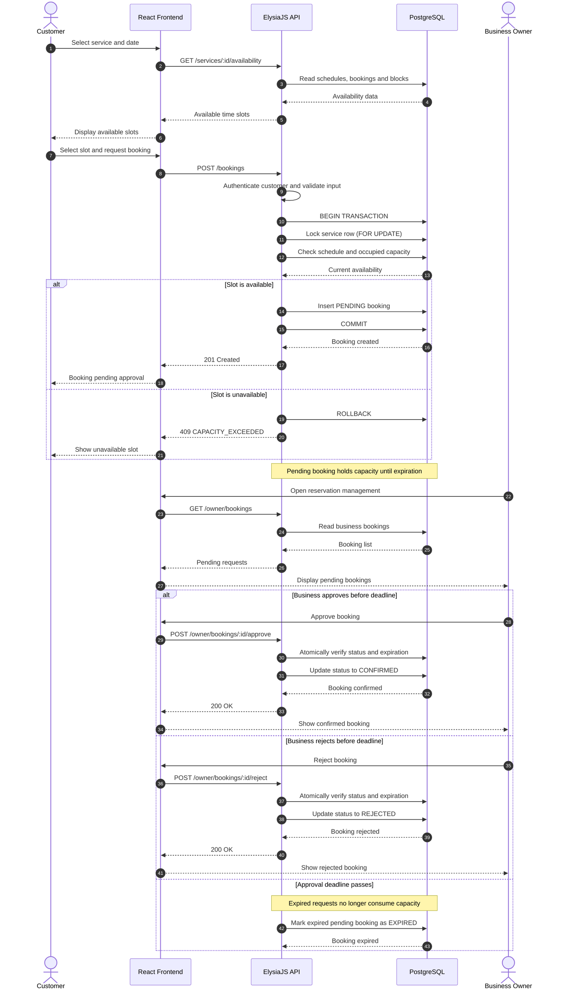

# BookFlow — Booking Sequence Diagram

## 1. Overview

This document describes the appointment booking process in BookFlow.

It covers:
- Customer availability checks.
- Booking request creation.
- Capacity validation.
- Transactional booking creation.
- Business approval or rejection.
- Automatic expiration of pending requests.

The process involves the React frontend, ElysiaJS backend, PostgreSQL database, and the business owner.

## 2. Booking Sequence Diagram

## 3. Booking Creation

### Step 1 — Availability Request

The customer selects a service and date.

The frontend requests available appointment slots from the backend.

The backend calculates availability using:
- Service duration.
- Service capacity.
- Recurring schedules.
- Availability exceptions.
- Active pending bookings.
- Confirmed bookings.
- External capacity blocks.

The frontend displays the available slots.

### Step 2 — Booking Request

The customer selects a time slot and submits a booking request.

The backend:
1. Authenticates the customer.
2. Validates the request.
3. Verifies that the business is approved and the service is active.
4. Starts a PostgreSQL transaction.
5. Locks the corresponding service row.
6. Recalculates availability and capacity.
7. Creates the booking with PENDING status.
8. Commits the transaction.

If the requested capacity is unavailable, the transaction is rolled back and the API returns a conflict error.

### Step 3 — Pending Approval

A successfully created booking receives PENDING status.

The booking temporarily reserves capacity.

The approval deadline is calculated as:

`expiresAt = min(createdAt + 24 hours, startAt)`

The business must approve or reject the request before this deadline.

### Step 4 — Business Decision

The business owner reviews pending reservations.

Possible actions:

**Approve**
- The backend verifies ownership, status, and expiration.
- The booking changes from PENDING to CONFIRMED.
- The reservation continues to occupy capacity.

**Reject**
- The backend verifies ownership, status, and expiration.
- The booking changes from PENDING to REJECTED.
- Reserved capacity is released.

### Step 5 — Automatic Expiration

If the business does not respond before the deadline, the request expires.

Expired pending bookings must not occupy capacity, even if a background cleanup process has not yet updated their stored status.

Expiration may be implemented using a scheduled cleanup task and expiration checks during relevant API operations.

## 4. Concurrency Protection

Booking creation must prevent simultaneous requests from exceeding service capacity.

The backend uses a PostgreSQL transaction and locks the corresponding service row.

All operations that change capacity must follow the same locking strategy.

Availability must be recalculated inside the transaction.

This prevents two concurrent requests from independently observing the same available capacity and both exceeding the limit.

## 5. Error Handling

| Condition | API Response |
|---|---|
| Customer is not authenticated | 401 UNAUTHENTICATED |
| Customer lacks permission | 403 FORBIDDEN |
| Invalid booking request | 422 VALIDATION_ERROR |
| Service does not exist | 404 NOT_FOUND |
| Business is not approved | 409 BUSINESS_NOT_APPROVED |
| No available capacity | 409 CAPACITY_EXCEEDED |
| Pending booking has expired | 409 BOOKING_EXPIRED |
| Invalid booking transition | 409 INVALID_BOOKING_STATUS |

## 6. Important Rules

- Only customers may create booking requests.
- Only approved businesses may receive bookings.
- Each service has independent capacity.
- Pending bookings occupy capacity until expiration.
- Confirmed bookings occupy capacity until completion or cancellation.
- Approval must occur before the expiration deadline.
- Rejected, cancelled, and expired bookings release capacity.
- All capacity-changing operations must be concurrency-safe.
- Backend authorization is mandatory for all protected operations.

## 7. Related Documentation

- `../requirements.md`
- `../architecture.md`
- `../database-design.md`
- `../api-contract.md`
- `class-diagram.md`
- `use-cases.md`
