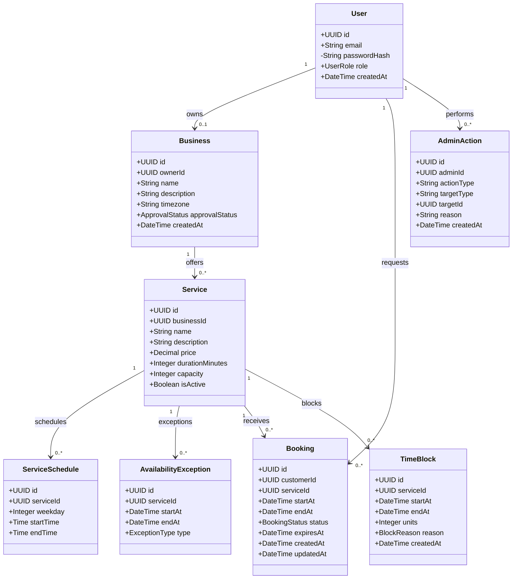

# BookFlow — Class Diagram

## 1. Overview

This diagram represents the main data entities of BookFlow, their attributes, and their relationships.

It is based on the database design and describes the logical structure of the appointment booking system.

## 2. Class Diagram

## 3. Entity Descriptions

| Entity | Responsibility |
|---|---|
| User | Stores accounts, credentials and roles |
| Business | Represents registered businesses and approval status |
| Service | Defines services, prices, durations and independent capacity |
| ServiceSchedule | Defines recurring weekly availability |
| AvailabilityException | Represents exceptional openings and closures |
| Booking | Stores customer reservations and their statuses |
| TimeBlock | Blocks service capacity for external appointments or unavailability |
| AdminAction | Records administrative interventions |

## 4. Relationships and Cardinalities

- A user may own zero or one business.
- A business belongs to exactly one owner.
- A business may offer multiple services.
- A service belongs to exactly one business.
- A service may have multiple schedules.
- A service may have multiple availability exceptions.
- A customer may create multiple bookings.
- Each booking belongs to exactly one customer and one service.
- A service may have multiple bookings and time blocks.
- An administrator may perform multiple administrative actions.

The relationships involving User depend on the user's role.

Only BUSINESS_OWNER accounts may own businesses, CUSTOMER accounts may create bookings, and ADMIN accounts may perform administrative actions.

These role restrictions are enforced by backend authorization.

## 5. Enumerations

### UserRole

- CUSTOMER
- BUSINESS_OWNER
- ADMIN

### ApprovalStatus

- PENDING
- APPROVED
- REJECTED

### BookingStatus

- PENDING
- CONFIRMED
- REJECTED
- CANCELLED
- EXPIRED
- COMPLETED

### ExceptionType

- CLOSED
- OPEN

### BlockReason

- EXTERNAL_BOOKING
- UNAVAILABLE

## 6. Important Constraints

- User emails must be unique.
- A business owner may register only one business.
- Services must have positive duration and capacity.
- Service prices must be non-negative.
- Appointment end times must be later than start times.
- Pending and confirmed bookings occupy capacity.
- Expired pending bookings no longer occupy capacity.
- Time blocks reduce the capacity of their corresponding service.
- Booking creation must prevent concurrent overbooking.
- Administrative interventions require an audit record.

## 7. Implementation Notes

This diagram represents the logical data model, not the complete application code.

The backend will implement these entities using Drizzle ORM and PostgreSQL.

The final database schema may include additional indexes, constraints, session tables, or supporting entities.

All changes must remain consistent with the software requirements, database design, and API contract.
