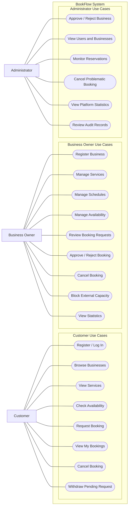

# BookFlow — Use Case Diagram

## 1. Overview

This diagram represents the main interactions between BookFlow and its three user roles:

- **Customer:** Searches for services, books appointments, and manages reservations.
- **Business Owner:** Manages business services, availability, reservations, and statistics.
- **Administrator:** Approves businesses, supervises the platform, and resolves booking problems.

## 2. Use Case Diagram

The following Mermaid flowchart represents the system's use cases and their associated actors.

## 3. Customer Use Cases

| ID | Use Case | Description |
|---|---|---|
| UC-01 | Register / Log In | Create an account and authenticate |
| UC-02 | Browse Businesses | Search and explore approved businesses |
| UC-03 | View Services | View available services, prices, and durations |
| UC-04 | Check Availability | View available appointment slots |
| UC-05 | Request Booking | Submit a booking request for approval |
| UC-06 | View My Bookings | View upcoming and previous reservations |
| UC-07 | Cancel Booking | Cancel a confirmed booking at least 12 hours before its start |
| UC-08 | Withdraw Pending Request | Withdraw a booking awaiting approval |

## 4. Business Owner Use Cases

| ID | Use Case | Description |
|---|---|---|
| UB-01 | Register Business | Submit a business for administrative approval |
| UB-02 | Manage Services | Create, update, and deactivate services |
| UB-03 | Manage Schedules | Configure recurring service schedules |
| UB-04 | Manage Availability | Configure exceptional openings and closures |
| UB-05 | Review Booking Requests | View pending booking requests |
| UB-06 | Approve / Reject Booking | Respond to requests within the approval deadline |
| UB-07 | Cancel Booking | Cancel confirmed bookings at least 6 hours before their start |
| UB-08 | Block External Capacity | Reserve service capacity for external appointments |
| UB-09 | View Statistics | View booking totals, statuses, and popular services |

## 5. Administrator Use Cases

| ID | Use Case | Description |
|---|---|---|
| UA-01 | Approve / Reject Business | Review business registration requests |
| UA-02 | View Users and Businesses | Supervise registered accounts and businesses |
| UA-03 | Monitor Reservations | Search and inspect platform bookings |
| UA-04 | Cancel Problematic Booking | Cancel a booking with a mandatory audit reason |
| UA-05 | View Platform Statistics | Access platform-wide statistics |
| UA-06 | Review Audit Records | Inspect recorded administrative actions |

## 6. Important Business Rules

- Only approved businesses can publish services and receive bookings.
- Customers request appointments; businesses approve or reject them.
- Pending bookings temporarily occupy service capacity.
- Approval must occur within 24 hours or before the appointment starts, whichever comes first.
- Customers can cancel confirmed bookings at least 12 hours before the appointment.
- Business owners can cancel confirmed bookings at least 6 hours before the appointment.
- Service capacity is independent for each service.
- External reservations block capacity without storing external customer information.
- Administrative cancellations require a recorded reason.
- The backend must enforce authorization and prevent overbooking.

## 7. Diagram Notes

This diagram uses Mermaid flowchart syntax to visualize use cases.

It is a use-case-oriented representation rather than a strict UML use case diagram. The nodes represent system functions, and the connections indicate which actors can initiate them.

Detailed system behavior and interactions will be described in the sequence diagrams.
